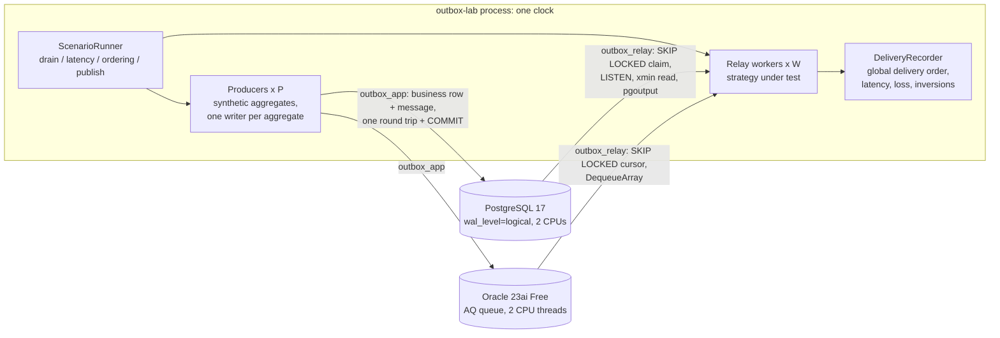

# outbox-lab

[](https://github.com/hekimcan206/outbox-lab/actions/workflows/ci.yml)
[](https://github.com/hekimcan206/outbox-lab/actions/workflows/codeql.yml)


[](LICENSE)

A measured comparison of transactional-outbox relays on **PostgreSQL** (`FOR UPDATE SKIP LOCKED`, LISTEN/NOTIFY,
a commit-horizon cursor, logical decoding) and **Oracle** (`FOR UPDATE SKIP LOCKED`, Advanced Queuing): throughput,
commit-to-delivery latency, what each one costs the business transaction, and whether it loses, duplicates or
reorders messages. One harness runs every strategy, so the differences come from the strategy, not the test.

This is a lab, not a library: each relay is the smallest correct implementation of its pattern, and the deliverable
is the numbers and the reasoning.

> All data is synthetic: integer aggregate ids, sequence numbers, timestamps and filler bytes. There is no real
> personal or business data.

## Problem

A service writes a business row and must publish an event about it. Writing to the database and to a broker are two
systems with no shared transaction, so the outbox pattern writes the event into the database in the same transaction
and lets a relay move it to the broker. Every team that adopts it then faces the same questions, usually answered by
folklore:

1. **How does the relay find new messages?** Poll on an interval, wake up on `NOTIFY`, block on a queue, or stream the
   WAL? Each answer trades latency, database load and operational risk.
2. **Does it keep order?** Consumers usually need the events of one aggregate in order. Competing workers break that;
   a single reader may not keep up.
3. **Can it lose a message?** The most obvious design (remember the highest id delivered) loses messages, because ids
   are assigned at INSERT and transactions commit out of id order.
4. **What does it cost the write path?** `NOTIFY` takes a global lock at commit; an AQ enqueue is not free either.

## What is compared

| Strategy | Engine | Producer writes | Relay finds messages by | Order |
|---|---|---|---|---|
| `pg-skip-locked` | PostgreSQL | business row + outbox row | polling `FOR UPDATE SKIP LOCKED` every 100 ms when idle | competing workers |
| `pg-notify` | PostgreSQL | same + `pg_notify` | same claim, idle workers wait on `LISTEN` | competing workers |
| `pg-xmin` | PostgreSQL | same (row carries `xid8` txid) | one reader, rows below `pg_snapshot_xmin`, `(txid, id)` order | per aggregate, by construction |
| `pg-logical` | PostgreSQL | business row + transactional `pg_logical_emit_message` | pgoutput replication stream, no table | commit order |
| `pg-id-cursor` | PostgreSQL | business row + outbox row | `id > last` high-water mark | **loses messages** (kept to measure it) |
| `ora-skip-locked` | Oracle | business row + outbox row (one PL/SQL block) | `FOR UPDATE SKIP LOCKED` cursor, fetch one batch | competing workers |
| `ora-aq` | Oracle | business row + `DBMS_AQ.ENQUEUE` (ON_COMMIT) | blocking `DequeueArray` | FIFO per dequeuer |

Every producer writes the business row and the message in **one round trip plus COMMIT**; every relay delivers before
it acknowledges (at-least-once, [ADR 0005](docs/adr/0005-at-least-once-delivery-and-consumer-deduplication.md)).

## Architecture



Why one transaction can be delivered "late" and what each relay does about it:

```mermaid
sequenceDiagram
    participant A as Producer A (aggregate 1)
    participant B as Producer B (aggregate 2)
    participant DB as Outbox
    participant R as Relay
    A->>DB: BEGIN; INSERT (id 41, txid 900)
    B->>DB: BEGIN; INSERT (id 42, txid 901); COMMIT
    R->>DB: read
    Note over R: id cursor: delivers 42, cursor = 42<br/>xmin: horizon is 900, delivers nothing yet<br/>logical: decodes txid 901 (committed)<br/>SKIP LOCKED / AQ: delivers 42
    A->>DB: COMMIT
    R->>DB: read
    Note over R: id cursor: asks id > 42, never sees 41 (lost)<br/>xmin: delivers 41 then 42, in txid order<br/>logical and SKIP LOCKED / AQ: deliver 41
```

### Why this design

- **One harness, in-process sink, one clock** ([ADR 0001](docs/adr/0001-one-harness-for-every-strategy.md)). The
  relay hands messages to an in-process recorder instead of a broker, so the measurement is the outbox, not Kafka.
  The producing transaction's start timestamp travels inside the payload; latency is one subtraction on one
  monotonic clock.
- **Open-loop latency.** A ticker schedules sends at a fixed rate whatever the system does, so a slow relay shows up
  as latency instead of silently slowing the producers down.
- **Same budget for both engines.** Oracle Database Free caps itself at 2 CPU threads; compose gives PostgreSQL the
  same 2 CPUs.
- **Correctness is measured, not assumed.** Gapless per-aggregate sequences make loss, duplicates and inversions
  countable in every run, and the integration tests pin each strategy's semantics step by step.

## Results

Measured on a laptop (i7-13620H, Docker Desktop on WSL2, host not idle), both databases limited to 2 CPUs, medians of
three runs. Method, environment, spreads and raw data: [docs/benchmarks.md](docs/benchmarks.md) and
`benchmark-results/`.

| Strategy | Drain, 1 worker | Drain, 4 workers | Latency p50 / p99 at 100 /s | Publish at 32 writers | Lost under commit reordering | Per-aggregate order |
|---|---:|---:|---:|---:|---:|---|
| `pg-skip-locked` | 10,330 /s | 45,699 /s | 68.8 / 157.6 ms | 1,458 tx/s | 0 | 1 worker only (40 inversions with 4) |
| `pg-notify` | (same claim) | (same claim) | **6.0 / 25.6 ms** | **519 tx/s** | 0 | 1 worker only |
| `pg-xmin` | 9,852 /s | n/a (one reader) | 63.4 / 122.2 ms | (table write) | 0 | yes |
| `pg-logical` | **146,969 /s** | n/a (one stream) | **4.2 / 17.7 ms** | **1,842 tx/s** | 0 | yes (commit order) |
| `pg-id-cursor` | n/a | n/a | n/a | (table write) | **60-87 of 4,000** | n/a |
| `ora-skip-locked` | 7,566 /s | 13,755 /s | 64.7 / 135.4 ms | 1,746 tx/s | 0 | 1 worker only (49 inversions with 4) |
| `ora-aq` | 5,856 /s | 5,029 /s | **4.4 / 33.6 ms** | 1,350 tx/s | 0 | 1 worker (rarely broken with 4 at 700 /s) |

What stands out:

- **The obvious relay loses data.** Remembering the highest id delivered lost 1.5-2.2% of messages when commits were
  jittered by only 0-5 ms. The commit-horizon reader (`pg-xmin`) fixes it at no measurable cost.
- **`NOTIFY` in every business transaction caps the write path.** Throughput at 32 writers fell to 36% of a plain
  outbox insert (519 vs 1,458 tx/s), and the 500 /s latency run could not even produce 500 /s. It is great for idle
  latency with few writers and a trap with many.
- **Logical decoding is the best PostgreSQL outbox on every measured axis** (cheapest write, 4.2 ms p50, ordered,
  14x the drain rate of a single poller), and the worst operationally: a stopped relay pins WAL
  ([ADR 0003](docs/adr/0003-logical-decoding-with-transactional-messages.md)).
- **Oracle AQ gives push latency (4.4 ms p50) out of the box**, for about 23% of write throughput against a table
  outbox. On Database Free's two CPU threads, four dequeuers were no faster than one.
- **Polling costs the poll interval**, on both engines: 63-69 ms p50 at a 100 ms interval, reproducible to a few ms.
- **Competing workers reorder.** Every multi-worker design broke per-aggregate order on both engines; only single
  readers kept it in every run.

Integration tests pin each semantic step by step: the id cursor skipping a late commit, `pg-xmin` holding a newer row
until the older transaction commits, the WAL stream following commit order and never emitting a rolled-back message,
a SKIP LOCKED or AQ relay crashing mid-batch and leaving every message for redelivery, a logical relay resuming from
its slot, NOTIFY waking an idle relay while a poller sleeps, Oracle's `ROWNUM ... SKIP LOCKED` returning nothing, and
every role being denied what it should not touch.

### Demo output

The end of `docker compose up` on the development machine (one demo-scale run per strategy; small drains are too
short to read as throughput):

```text
| pg-id-cursor | PostgreSQL | 1 | 1,500 | 1,473 | 27 | 0 | 0 | 0 | hold 0-3 ms |
| pg-skip-locked | PostgreSQL | 4 | 1,500 | 1,500 | 0 | 0 | 0 | 0 | hold 0-3 ms |
| pg-xmin | PostgreSQL | 1 | 1,500 | 1,500 | 0 | 0 | 0 | 0 | hold 0-3 ms |
| pg-logical | PostgreSQL | 1 | 1,500 | 1,500 | 0 | 0 | 0 | 0 | hold 0-3 ms |
| ora-skip-locked | Oracle | 4 | 1,500 | 1,500 | 0 | 0 | 15 | 11 | hold 0-3 ms |
| ora-aq | Oracle | 1 | 1,500 | 1,500 | 0 | 0 | 0 | 0 | hold 0-3 ms |

{"ok":true,"failures":[],"idCursorLost":27}
```

Columns: strategy, engine, workers, messages, delivered, missing, duplicates, inversions, aggregates hit, notes.

## Quick start

```bash
docker compose up --build           # PostgreSQL 17 + Oracle 23ai Free + the lab's demo run
docker compose logs -f lab          # tables per scenario, then {"ok":true,...}
docker compose down -v              # clean up
```

The demo runs every strategy at small scale (about two minutes once Oracle is up) and exits non-zero if a strategy
loses a message or an ordered strategy reorders one; CI runs exactly this.

Benchmarks run from the host against the same databases:

```bash
docker compose up -d postgres oracle
dotnet run -c Release --project src/OutboxLab.Runner -- bench all --runs 3 --out benchmark-results
dotnet run -c Release --project src/OutboxLab.Runner -- bench latency --strategies pg-notify,ora-aq
```

Tests: `dotnet test` (Docker running; PostgreSQL through Testcontainers). The Oracle suite starts
`gvenzl/oracle-free` and runs with `OUTBOX_ORACLE_TESTS=1 dotnet test --project tests/OutboxLab.OracleTests`.

## Repository map

| Path | What |
|---|---|
| `src/OutboxLab.Core` | Message codec, delivery recorder, ordering and latency analysis, scenario engine, report writer |
| `src/OutboxLab.Postgres` | Producer and the five PostgreSQL relays |
| `src/OutboxLab.Oracle` | Producer, SKIP LOCKED cursor relay, Advanced Queuing relay |
| `src/OutboxLab.Runner` | `outbox-lab demo` and `outbox-lab bench`, OTLP telemetry |
| `deploy/*/init` | Schema, queue and least-privilege roles; shared by docker compose and the tests |
| `tests/` | Unit, FsCheck property and golden tests; PostgreSQL and Oracle Testcontainers suites |
| `benchmark-results/` | Raw runs and medians behind every number below |
| `docs/` | [Benchmarks](docs/benchmarks.md), [threat model](docs/threat-model.md), [ADRs](docs/adr) |

## Limitations and next steps

- **Laptop numbers.** One host, Docker Desktop on WSL2, both databases on the same disk, the lab on the host going
  through port forwarding, and a host that was not idle (docs/benchmarks.md has the load). Ratios and qualitative
  findings carry over; absolute throughput does not.
- **Oracle Database Free only** (2 CPU threads, 2 GB). Enterprise Edition, RAC and Exadata behave differently,
  and Transactional Event Queues (AQ's high-throughput successor) were not measured.
- **No broker.** Publish cost to Kafka or RabbitMQ is excluded by design; it adds the same cost to every strategy.
- **Ordered and parallel at once is not covered.** Partitioning aggregates across ordered workers (with ownership
  coordination), or AQ message grouping, is the next experiment.
- **Failure modes not exercised:** primary failover with a logical slot (PostgreSQL 17 failover slots), WAL retention
  limits (`max_slot_wal_keep_size`), long-running transactions holding back `pg-xmin`, poison messages blocking an
  ordered reader (there is no dead-letter path).
- **Steady state, not soak.** Runs last seconds to tens of seconds; queue-table bloat and vacuum behaviour over hours
  are not measured.

## Privacy

Everything is synthetic and generated at run time; there is nothing subject to KVKK (the Turkish personal data
protection law) or GDPR. The threat model covers what a production adoption of these relays must protect.

## License

[MIT](LICENSE)
